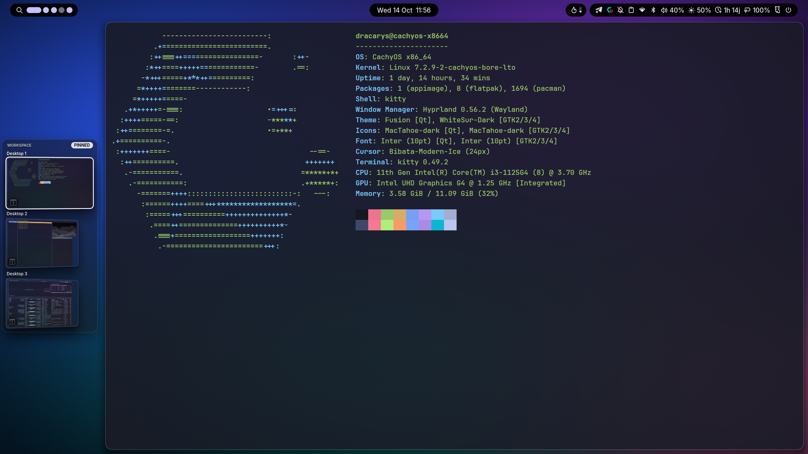
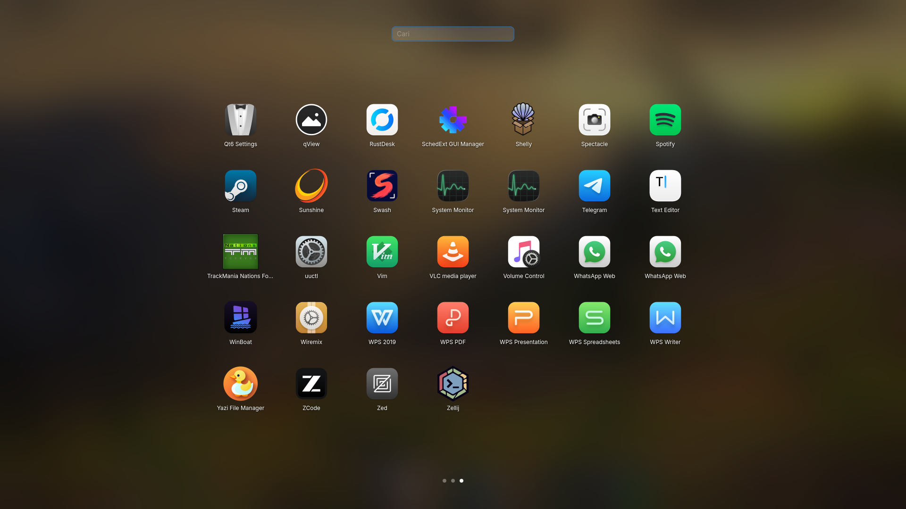
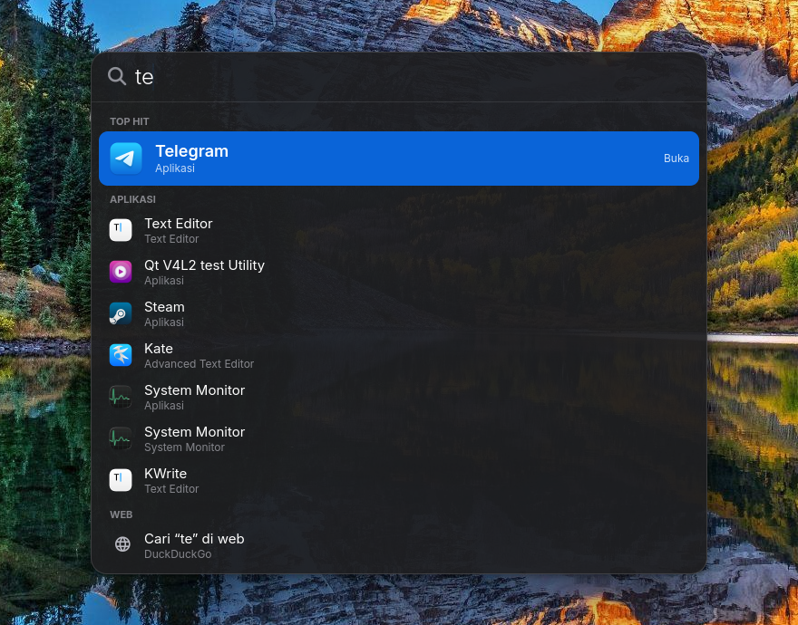
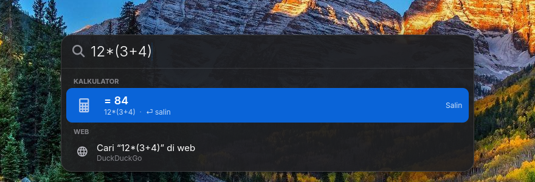
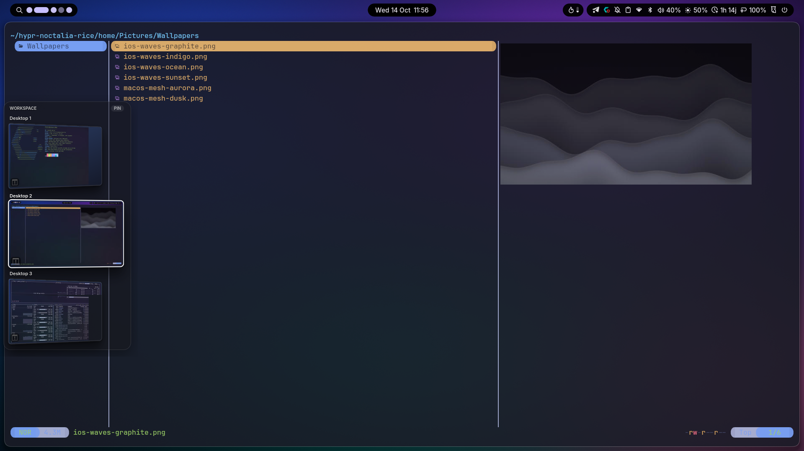
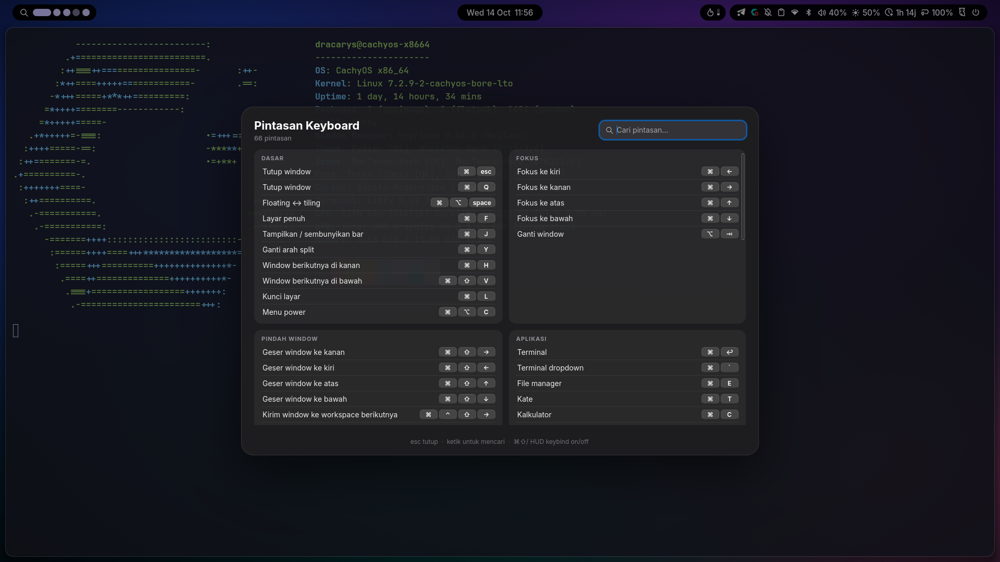

# hypr-noctalia-rice

Rice Hyprland + [noctalia](https://github.com/noctalia-dev/noctalia) bernuansa macOS/iOS, diambil dari laptop CachyOS.
Bisa dipasang ke laptop atau PC lain berbasis Arch dengan satu skrip.

Kalau kepakai, kasih ⭐ ya. Issue dan PR juga dipersilakan.





| Spotlight (Super+Space) | Kalkulator inline di Spotlight |
|---|---|
|  |  |

| Strip workspace (mode hover, kartu 3D) | Cheatsheet keybind (Super+/) |
|---|---|
|  |  |

- [Isi rice](#isi-rice)
- [Tutorial pasang dari nol](#tutorial-pasang-dari-nol)
  - [0. Syarat](#0-syarat)
  - [1. Siapkan sistem](#1-siapkan-sistem)
  - [2. Clone](#2-clone)
  - [3. Coba dulu (dry-run)](#3-coba-dulu-dry-run)
  - [4. Pasang](#4-pasang)
  - [5. Login ke Hyprland](#5-login-ke-hyprland)
  - [6. Cek semuanya jalan](#6-cek-semuanya-jalan)
  - [7. Sesuaikan dengan mesin](#7-sesuaikan-dengan-mesin)
- [Shortcut](#shortcut)
- [Update di mesin yang sudah terpasang](#update-di-mesin-yang-sudah-terpasang)
- [Membatalkan / kembali ke config lama](#membatalkan--kembali-ke-config-lama)
- [Troubleshooting](#troubleshooting)
- [Merawat repo (mesin utama)](#merawat-repo-mesin-utama)
- [Catatan teknis](#catatan-teknis)
- [Lisensi & kredit](#lisensi--kredit)

## Isi rice

| Bagian | Keterangan |
|---|---|
| **Hyprland** (`~/.config/hypr`, config Lua) | Dekorasi squircle + blur, animasi pegas ala iOS, perpindahan workspace vertikal, swipe 4 jari atas/bawah, mode layar proyektor |
| **noctalia** (`~/.local/state/noctalia/settings.toml`) | Bar "Dynamic Island", dock ngambang + magnifikasi, lock screen ala iOS, hot corner, Night Light, plugin `uptime` & `spotlight` (tombol kaca pembesar di bar) |
| **spotlight** | Launcher ala Spotlight macOS: awalnya cuma bar pencarian, hasil Top Hit / Aplikasi muncul saat mengetik, kalkulator inline (Enter = salin), cari di web. Aplikasi yang sering dibuka naik ke atas |
| **Launchpad** (bagian dari daemon spotlight) | Grid ikon semua aplikasi layar penuh ala macOS: 7×5 per halaman, latar desktop diblur, pencarian, geser halaman pakai touchpad/scroll/←→. Dibuka lewat ikon di dock, Super+G, atau cubit 4 jari |
| **wsstrip** | Strip workspace di kiri (kartu 3D gaya Stage Manager). Muncul saat kursor di tepi kiri, bisa di-pin jadi kolom tetap (5 workspace, yang kosong disembunyikan) |
| **keyhud** | HUD kecil tiap kali keybind ditekan + cheatsheet (Super+/) |
| **noctalia-keepalive** | Menyalakan ulang noctalia kalau mati (mis. setelah suspend) |
| **kitty** | Tema Tokyo Night, terminal dropdown (Super+\`), kitten scroll/search |
| **Wallpaper** | 6 wallpaper orisinal gaya iOS/macOS (digenerate, bukan aset Apple) |
| **Tema** | Font Inter + JetBrains Mono Nerd, ikon & kursor MacTahoe, qt6ct, adw-gtk3-dark |

Struktur repo:

```
hypr-noctalia-rice/
├── install.sh      # pasang paket + config ke $HOME
├── sync.sh         # tarik config dari mesin utama ke repo
├── packages.txt    # daftar paket
├── screenshots/    # gambar README
└── home/           # cermin isi $HOME (path home ditulis @HOME@)
    ├── .config/{hypr,noctalia,kitty,qt6ct,uwsm}
    ├── .local/{bin,lib,share/noctalia-plugins,state/noctalia}   # bin+lib: wsstrip, keyhud, spotlight
    └── Pictures/Wallpapers
```

---

## Tutorial pasang dari nol

### 0. Syarat

- **Distro berbasis Arch**: CachyOS (paling mulus, semua paket ada di repo), Arch, EndeavourOS, dll.
- **Hyprland ≥ 0.56**, karena config-nya pakai format **Lua** (bukan `hyprland.conf` lama).
  Cek di repo distro: `pacman -Si hyprland | grep Version`.
- Akun user biasa dengan `sudo`. **Jangan** jalankan skrip sebagai root.
- Koneksi internet: paket dan tema ikon diunduh saat install.
- GPU Intel/AMD langsung jalan. Untuk NVIDIA, buka komentar baris NVIDIA di
  `~/.config/uwsm/env` setelah install.

### 1. Siapkan sistem

Perbarui sistem dan pasang alat dasar:

```bash
sudo pacman -Syu
sudo pacman -S --needed git base-devel
```

**AUR helper.** Di CachyOS `paru` biasanya sudah ada, jadi langkah ini bisa dilewati.
Di Arch polos dibutuhkan untuk `noctalia-git`:

```bash
cd /tmp && git clone https://aur.archlinux.org/paru-bin.git
cd paru-bin && makepkg -si
```

**Display manager.** Layar login grafis biasanya sudah ada. Kalau belum, pasang SDDM:

```bash
sudo pacman -S --needed sddm
sudo systemctl enable sddm
```

Tanpa display manager pun bisa: login di TTY lalu jalankan `uwsm start hyprland.desktop`.

### 2. Clone

```bash
cd ~
git clone https://github.com/nohypelabs/hypr-noctalia-rice.git
cd hypr-noctalia-rice
```

### 3. Coba dulu (dry-run)

Lihat apa saja yang akan dipasang dan ditulis, tanpa mengubah apa pun:

```bash
./install.sh --dry-run
```

Perhatikan daftar `cp`/`tulis`: file-file itu akan ditimpa di `$HOME`. Versi lama yang isinya beda
otomatis dibackup (lihat langkah 4).

### 4. Pasang

```bash
./install.sh
```

Skrip akan meminta password `sudo` untuk `pacman`. Urutannya:

1. **Paket** dari `packages.txt`: Hyprland, uwsm, noctalia, portal, gtk4-layer-shell, kitty, yazi, font, dll.
   Paket yang gak ada di repo resmi dicari lewat `paru`/`yay`. Di Arch polos, `noctalia` otomatis
   diganti `noctalia-git` dari AUR.
2. **Ikon & kursor MacTahoe** di-clone dari github.com/vinceliuice/MacTahoe-icon-theme lalu dipasang
   ke `~/.local/share/icons`. Langkah ini dilewati kalau tema-nya sudah ada.
3. **Config** dari `home/` disalin ke `$HOME`, dengan `@HOME@` diganti path home mesin ini.
   File lama yang beda isinya dibackup ke `~/.local/share/hypr-noctalia-rice/backup-<tanggal-jam>/`.
4. **Pengecekan**: versi Hyprland, noctalia, binding Python gtk4-layer-shell, dan validasi setelan noctalia.

Akhir yang sukses kira-kira begini:

```
 ✓ 40 file disalin
 ✓ Hyprland 0.56.2 (butuh >= 0.56 untuk config Lua)
 ✓ noctalia ada
 ✓ gtk4-layer-shell untuk Python OK
 ✓ settings noctalia valid
```

Kalau ada baris kuning `!`, lihat [Troubleshooting](#troubleshooting) sebelum lanjut.

Opsi lain:

| Opsi | Kegunaan |
|---|---|
| `--no-packages` | Config saja, paket gak disentuh (dipakai saat update) |
| `--no-backup` | Timpa langsung tanpa backup |
| `--dry-run` | Tampilkan rencana tanpa mengubah apa pun |

### 5. Login ke Hyprland

1. Logout (atau reboot).
2. Di layar login, pilih sesi **Hyprland (uwsm-managed)**. Pilihan sesi biasanya ada di pojok layar login.
   Jangan pilih "Hyprland" yang biasa: env di `~/.config/uwsm/env` (kursor, tema Qt/GTK)
   hanya terbaca lewat uwsm.
3. Login.

Saat pertama masuk, noctalia (bar, dock, wallpaper), keyhud, dan wsstrip dinyalakan otomatis oleh
`~/.config/hypr/config/autostart.lua`.

### 6. Cek semuanya jalan

Buka terminal (**Super+Enter**) lalu jalankan:

```bash
hyprctl configerrors                        # harus kosong
pgrep -a noctalia                           # bar & dock
pgrep -af keyhud.py                         # HUD keybind
pgrep -af wsstrip.py                        # strip workspace
pgrep -af spotlight.py                      # launcher Spotlight
noctalia msg plugins list | grep uptime     # plugin uptime aktif
```

Lalu tes langsung:

- [ ] Bar di atas dan dock di bawah muncul, wallpaper terpasang.
- [ ] **Super+/** membuka cheatsheet keybind.
- [ ] Kursor ditempel ke tepi kiri layar (bagian tengah) → strip workspace geser masuk.
- [ ] **Super+Ctrl+Tab** → strip ter-pin, window bergeser ke kanan.
- [ ] Ikon grid warna-warni paling kiri di dock (atau **Super+G**) membuka Launchpad.
- [ ] **Super+Space** membuka Spotlight. Ketik `12*7` → muncul hasil kalkulator. **Super+L** mengunci layar.
- [ ] Swipe 4 jari ke atas/bawah di touchpad pindah workspace.

### 7. Sesuaikan dengan mesin

| File | Yang biasanya diubah |
|---|---|
| `~/.config/hypr/config/variables.lua` | `MONITOR1` (nama output, cek `hyprctl monitors`), `BROWSER`, `EDITOR`, `CALCULATOR` |
| `~/.config/hypr/config/binds.lua` | Beberapa bind menunjuk aplikasi yang gak ikut dipasang: `kate` (Super+T), `kcalc` (Super+C), `brave` (Super+B), `obs` (Super+R). Ganti atau pasang aplikasinya. |
| `~/.config/hypr/config/inputs.lua` | Layout keyboard, sensitivitas touchpad & swipe workspace |
| `~/.config/uwsm/env` | `BROWSER`, baris NVIDIA |
| Settings noctalia (klik ikon di bar) | Wallpaper per monitor, cuaca/lokasi, Night Light |

Habis mengubah config Hyprland, cukup simpan: Hyprland reload otomatis. Cek error-nya dengan
`hyprctl configerrors`.

---

## Shortcut

Daftar lengkap: **Super+/**.

| Tombol | Aksi |
|---|---|
| Super+Enter / Super+\` | Terminal / terminal dropdown |
| Super+Space | Spotlight (↑↓ pilih, Enter buka, Esc hapus/tutup) |
| Super+G / ikon grid di dock / cubit 4 jari | Launchpad (ketik untuk cari, ←→ atau geser touchpad ganti halaman, Esc tutup) |
| Super+E | File manager (yazi) |
| Super+Q / Super+Esc | Tutup window |
| Super+F | Layar penuh |
| Super+1…0 | Ke workspace 1–10 (Super+Shift+angka = kirim window) |
| tepi kiri layar / Super+Tab | Strip workspace (keyboard: 1–5, ↑↓, Enter, Esc) |
| Super+Ctrl+Tab | Pin / lepas strip workspace |
| Super+Shift+Tab | Ganti gaya animasi strip (pintu, geser, flip, zoom, kipas) |
| Super+V | Riwayat clipboard |
| Super+N | Control center |
| Super+L | Kunci layar |
| Super+Shift+E | Menu power |
| Super+Shift+W | Wallpaper acak |
| PrtSc / Shift+PrtSc / Super+PrtSc | Screenshot area / layar penuh / anotasi |
| Super+P | Atur monitor (nwg-displays) |
| Super+Shift+P / Super+Ctrl+P | Proyektor: duplikat / perpanjang |
| swipe 4 jari ↑↓ | Pindah workspace |
| cubit 4 jari | Launchpad |
| swipe 3 jari ↑ / ↓ / ← | Fullscreen / tutup / float |

Hot corner: kanan atas = control center, kiri bawah = Spotlight, kanan bawah = kunci layar.

---

## Update di mesin yang sudah terpasang

```bash
cd ~/hypr-noctalia-rice
git pull
./install.sh --no-packages        # tambah paket baru? jalankan tanpa --no-packages
```

Hyprland reload sendiri. noctalia, wsstrip, dan keyhud baru memakai versi baru setelah dinyalakan ulang,
paling gampang dengan logout lalu login lagi.

## Membatalkan / kembali ke config lama

Setiap install menyimpan file yang ditimpa di `~/.local/share/hypr-noctalia-rice/backup-<waktu>/`,
dengan struktur path yang sama seperti di `$HOME`:

```bash
ls ~/.local/share/hypr-noctalia-rice/
cp -a ~/.local/share/hypr-noctalia-rice/backup-20261014-120000/. ~/   # ganti dengan folder yang benar
```

File yang sebelumnya **belum ada** gak ikut dibackup. Hapus manual kalau perlu: daftarnya bisa dilihat di
`find home -type f` dalam repo ini.

---

## Troubleshooting

| Gejala | Penyebab & solusi |
|---|---|
| Layar login gak ada pilihan "Hyprland (uwsm-managed)" | `uwsm` belum terpasang: `sudo pacman -S uwsm`, lalu logout. |
| Masuk Hyprland tapi layar kosong / config error | Versi Hyprland < 0.56 (gak kenal config Lua). Cek `hyprctl version`, lalu update sistem. Detail error: `hyprctl configerrors`. |
| Bar & dock gak muncul | Jalankan `noctalia` dari terminal untuk lihat error-nya. Pastikan terpasang (`pacman -Q noctalia` atau `noctalia-git`). |
| Strip workspace / HUD gak muncul | `python3 -c 'import gi; gi.require_version("Gtk4LayerShell","1.0")'` harus tanpa error. Kalau gagal: `sudo pacman -S gtk4-layer-shell python-gobject python-cairo`. Untuk lihat error-nya: `pkill -f 'bin/wsstrip$'; pkill -f wsstrip.py; ~/.local/bin/wsstrip` dari terminal. |
| Super+Space membuka launcher lama noctalia | Daemon Spotlight gak jalan (itu cadangannya). Cek `pgrep -af spotlight.py`, jalankan `~/.local/bin/spotlight` dari terminal buat lihat error. |
| Strip muncul lalu kedip/hilang sebentar | Program strip crash lalu dinyalakan ulang otomatis. Cek `coredumpctl list python3` dan laporkan. |
| Ikon/kursor masih bawaan | Clone MacTahoe gagal saat install. Jalankan `./install.sh --no-backup` lagi saat online, atau pasang dari AUR: `paru -S mactahoe-icon-theme-git mactahoe-cursor-theme-git`. |
| Font aneh / kotak-kotak di bar | Font belum ada: `sudo pacman -S inter-font ttf-jetbrains-mono-nerd`, lalu logout. |
| Swipe touchpad gak pindah workspace | Swipe pakai **4 jari** atas/bawah. Sensitivitasnya di `inputs.lua` (`workspace_swipe_distance`). |
| Wallpaper hitam | Setelan noctalia menunjuk file yang gak ada. Tekan Super+Shift+W, atau pilih ulang di Settings noctalia. |
| `./install.sh: Permission denied` | `chmod +x install.sh sync.sh` |

---

## Merawat repo (mesin utama)

Habis ngoprek rice di mesin utama:

```bash
cd ~/hypr-noctalia-rice
./sync.sh        # tarik config yang sedang dipakai ke home/ (path → @HOME@)
git diff         # cek perubahan
git add -A && git commit -m "…" && git push
```

- `sync.sh` cuma memperbarui file yang **sudah ada** di `home/`. File baru (mis. tool baru di
  `~/.local/lib`) disalin manual dulu ke `home/<path yang sama>`.
- Wallpaper pribadi di setelan noctalia otomatis diganti `macos-mesh-aurora.png`, supaya repo gak
  menunjuk file yang gak ikut di-commit.
- Jangan commit rahasia: token, isi `.env`, password.

## Catatan teknis

- **wsstrip:** ikon aplikasi di kartu sengaja dirasterisasi jadi bitmap. Ikon SVG yang ikut
  dianimasikan bikin renderer GSK di GTK 4.24 abort (`gsk_gpu_render_pass_draw_clip_mask`).
- **wsstrip:** pemicu tepi kiri berupa strip 2px dengan alpha 1%, karena Hyprland gak kirim input
  mouse ke surface yang 100% transparan. Thumbnail kartu = tangkapan terakhir saat workspace itu
  terlihat (Hyprland gak bisa memotret workspace yang tersembunyi).
- **noctalia:** setelan yang aktif ada di `~/.local/state/noctalia/settings.toml` (ditulis GUI Settings)
  dan menimpa `~/.config/noctalia/config.toml`.
- **Sesi Plasma di mesin yang sama:** rice ini gak menulis `~/.config/gtk-3.0`/`gtk-4.0` dan
  `noctalia.service` gak di-enable, jadi Plasma gak ikut berubah.

## Lisensi & kredit

- Isi repo ini: [MIT](LICENSE), **kecuali** `home/.config/kitty/search.py` yang berasal dari
  [trygveaa/kitty-kitten-search](https://github.com/trygveaa/kitty-kitten-search) dan tetap berlisensi GPLv3.
- [noctalia](https://github.com/noctalia-dev/noctalia), [Hyprland](https://hypr.land),
  ikon & kursor [MacTahoe](https://github.com/vinceliuice/MacTahoe-icon-theme) karya vinceliuice,
  font [Inter](https://rsms.me/inter/). Semuanya dipasang dari sumber aslinya, bukan disalin ke repo ini.
- Wallpaper di `home/Pictures/Wallpapers` digenerate sendiri (bukan aset Apple) dan ikut lisensi MIT.
